# ClinicQueue — Fixing and Deploying an AI-Built App

**Live demo:** https://mhmdarfiansyahp-little-clinic-line.arfiansyah.workers.dev
**Built with:** Lovable (AI app builder) · **Audited, fixed and deployed by:** M. Arfiansyah Putra

ClinicQueue is a queue app for small clinics: patients take a number on their phone, staff call the
next patient, and a waiting-room screen shows who is being served. The first version was generated
with Lovable. This case study shows what happened after that: a security and quality audit, fixes in
the app's own stack, and a move off Lovable Cloud to infrastructure the owner controls.

| | |
|---|---|
| **Stack** | TanStack Start (React, TypeScript, Tailwind), Supabase (Postgres, Auth, Realtime), Cloudflare Workers |
| **Findings** | 13 (2 medium, 6 low, 5 info) |
| **Outcome** | 9 fixed, 1 verified, 2 accepted with reasons, 1 left to the platform |
| **Passed checks** | 11 security and quality checks that the AI got right |

---

## 1. Audit — what I checked

I tested the app the way an attacker or a confused user would, not only the happy path:

- Reading, editing and inserting data directly through the database API without logging in
- Opening staff and admin pages without a session
- Opening a patient ticket without its secret token
- Sending empty, malformed and very long form input
- Sending many registrations in parallel from the browser console
- Reviewing server functions, database functions and the build output

The full list is in [`before/findings.md`](before/findings.md).

### What the AI got right

Not everything was broken, and the report says so. Row-level security blocked anonymous reads and
writes, tickets required a private token, staff pages redirected to sign-in, queue numbers were
generated atomically, and the service role key only ran on the server.

---

## 2. Findings and fixes

### Medium — anyone could become the clinic admin
The `/setup` page was public until the first admin existed. Whoever found the URL first after a
deploy could create the admin account and take over the clinic.

**Fix:** setup now requires a secret `SETUP_TOKEN` stored as a server secret and compared in constant
time. If the secret is missing, setup is disabled. A failed setup also rolls back the new account,
so no half-created users are left behind.

**Verified end to end** on a fresh database: wrong code is rejected, correct code creates the admin,
`/setup` locks afterwards, and exactly one admin row exists.

| Wrong code | Correct code | Locked afterwards |
|---|---|---|
| 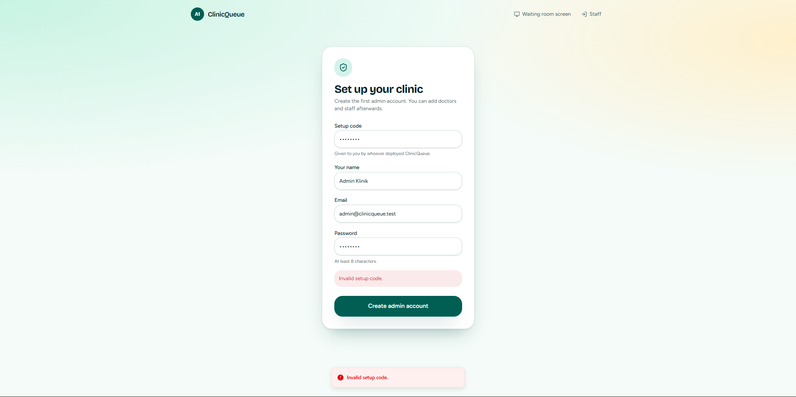 | 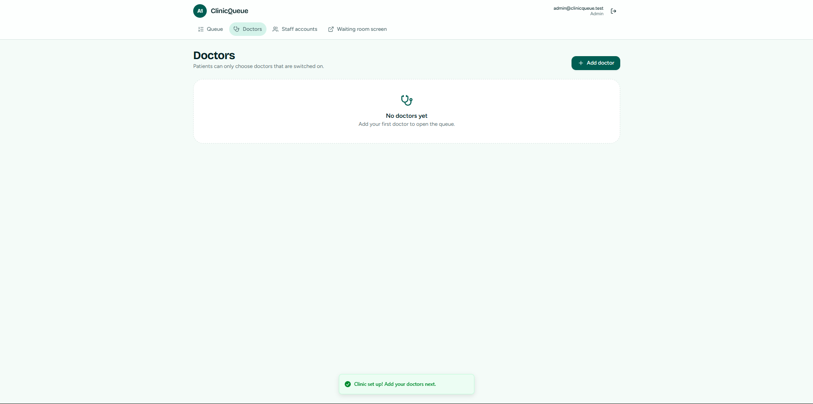 | 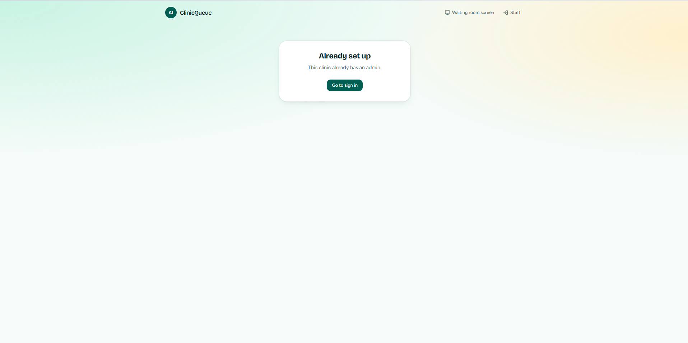 |

### Medium — unlimited registrations from one phone number
A short script registered 5 fake patients with the same phone number in one second. The
"you already have a number" warning only lived in the browser.

**Fix:** the `register_patient` database function now allows at most 3 active tickets per phone number
per day, takes an advisory lock so parallel requests cannot slip through, and requires at least
8 digits. The change was made through Lovable, as the project rules require, and I reviewed the
generated SQL before keeping it.

| Before: 5 of 5 accepted | After: 3 accepted, 2 rejected |
|---|---|
| 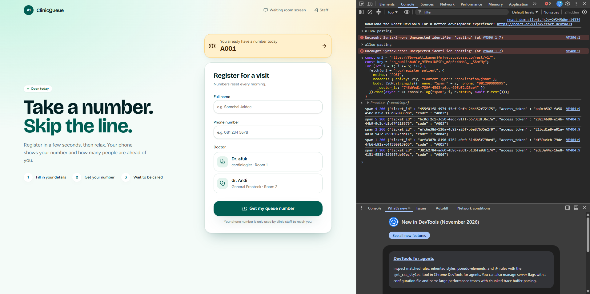 | 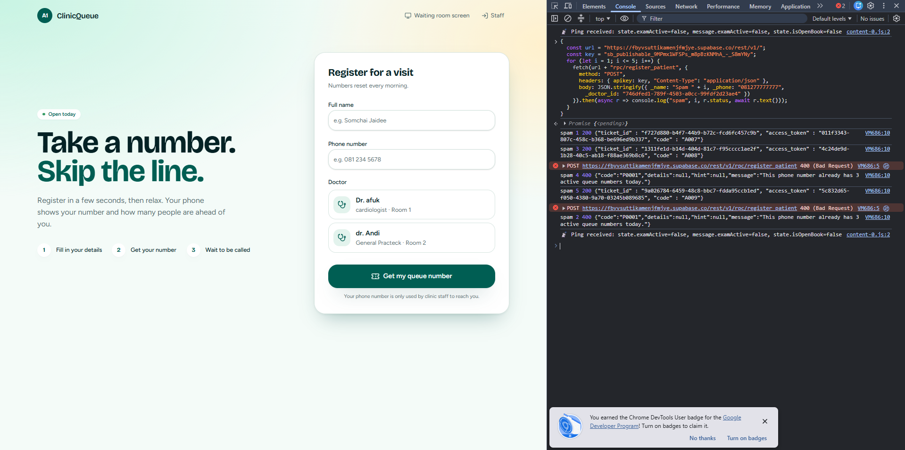 |

*Remaining risk:* an attacker rotating random phone numbers. Recommended follow-up: a captcha such as
Cloudflare Turnstile.

### Low and info

| Issue | Fix |
|---|---|
| Long names broke out of the ticket card | Truncate with "…", keep the "Today" label visible |
| Yesterday's tickets still said "Waiting · 0 people ahead" | Show "This number has expired" and an Expired badge |
| Form accepted 6-digit phones, server required 8 | Form now matches the server rule |
| Placeholder used a Thai name for an Indonesian clinic | "Budi Santoso" |
| Deprecated `inputValidator()` in 5 server functions | Replaced with `validator()` |

| Expired ticket — before | Expired ticket — after |
|---|---|
| 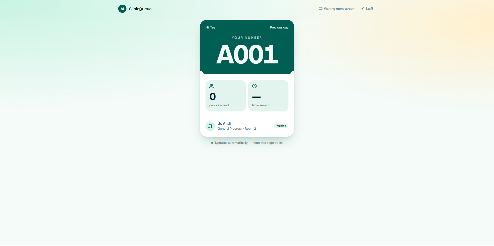 | 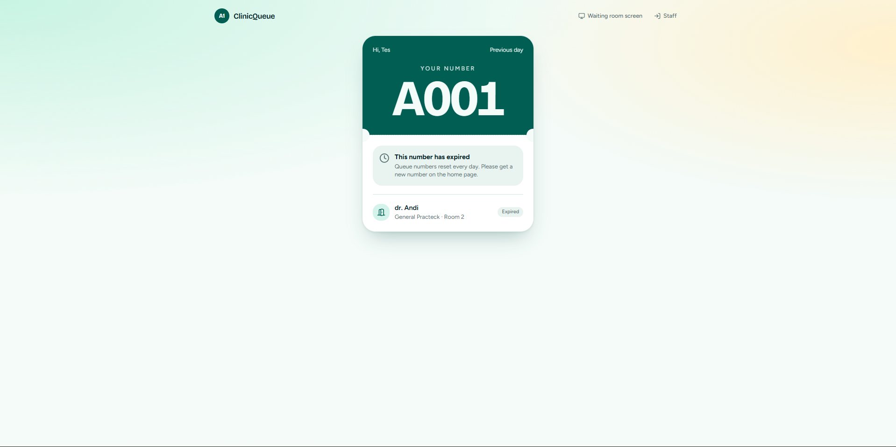 |

### Decisions I made on purpose
- **`.env` stays in the repo.** Removing it broke Lovable's preview. It only holds public values, and
  real secrets live in Lovable Secrets and Cloudflare secrets.
- **The 562 kB shared bundle stays.** Pages are already code-split. The shared chunk is React, the
  router and the Supabase client, and shrinking it would mean changing build config that Lovable manages.
- **The build plugin warning stays.** The plugin is injected by Lovable's own build package, and the
  project rules say not to add or remove those plugins by hand.

### Checking what the AI changed
Every change Lovable made was compared against what it said it changed. One edit quietly bumped a
build dependency; I verified the build still passed. Adding a secret produced two commits that only
touched a metadata file, with no code changes and no secret written to the repo.

---

## 3. Deployment — off Lovable Cloud

Lovable Cloud does not expose the Supabase service role key, so the admin features (first-admin
setup, staff accounts) could not run anywhere except inside Lovable.

1. Created a separate Supabase project and applied the schema from `drizzle/migrations`.
2. Built with the project's existing config, which already targets Cloudflare Workers.
3. Deployed with Wrangler and stored all server secrets as encrypted Cloudflare secrets.
4. Kept the repo connected to Lovable, so Lovable can still be used for previews and edits.

Every feature was then tested on the live URL:

| Patient registers | Staff calls next | Ticket updates live | Waiting-room screen |
|---|---|---|---|
| 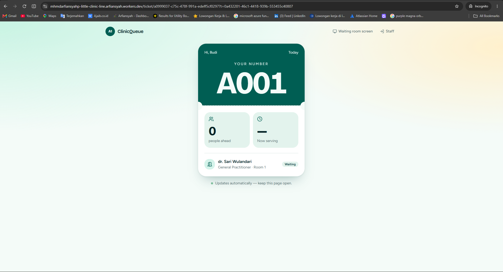 | 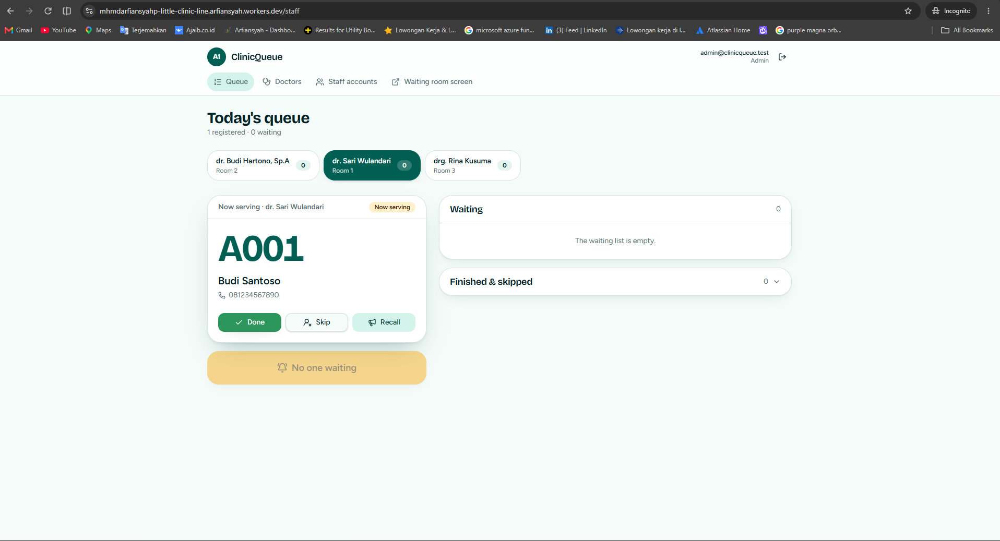 | 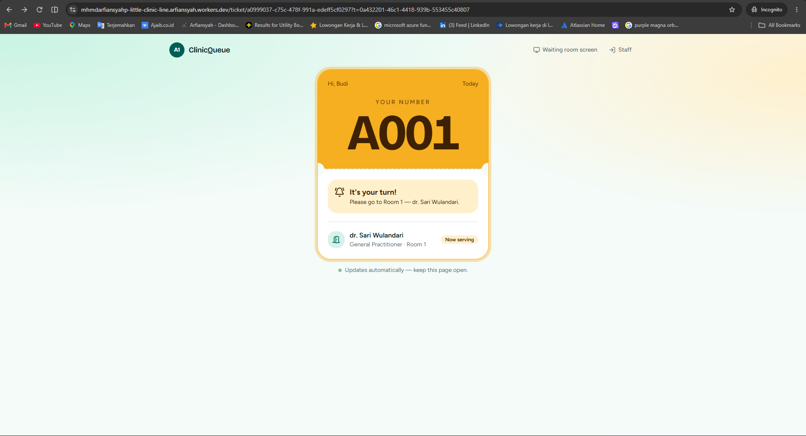 | 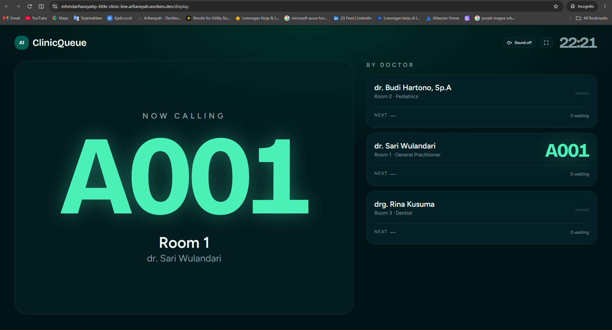 |

---

## Need the same for your app?

I fix and deploy apps built with Lovable, Bolt, Cursor, v0 and similar tools: security gaps, broken
logic, failing builds, and moving to your own hosting. Each fix is made in your existing stack, with a
report of what I found and what I changed.
